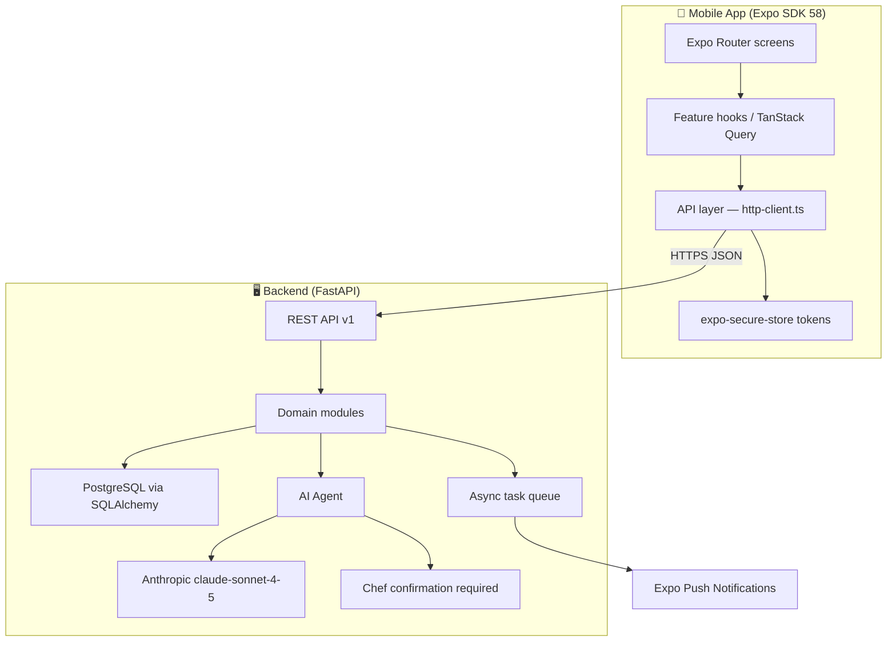

# <div align="center">Food Bundles — Chef App</div>

<div align="center">
  
</div>

<div align="center">
  
  
  
  
  

  <p align="center">
    <em>Order right. Receive right. Know your stock before service.</em><br>
    <strong>A full-stack kitchen operations platform for professional chefs</strong>
  </p>
</div>

<div align="center">
  
  
  
  
</div>

---

## Table of Contents

- [Overview](#overview)
- [Key Features](#key-features)
- [Tech Stack](#tech-stack)
- [Architecture](#architecture)
- [Project Structure](#project-structure)
- [Getting Started](#getting-started)
- [API Reference](#api-reference)
- [Implementation Status](#implementation-status)
- [Contact](#contact)

---

## Overview

**Food Bundles Chef App** is a chef-owned kitchen operations platform — *Menu du Jour* — that gives professional chefs full control over procurement, delivery receiving, stock visibility, menu planning, and AI-assisted kitchen decisions.

The platform is a monorepo with two applications:

| Application | Description |
|---|---|
| `mobile/` | React Native / Expo app for chefs (iOS + Android) |
| `backend/` | FastAPI REST backend with PostgreSQL, async task queue, and AI agent |

All kitchen data is fully isolated per chef and per kitchen. The AI agent is advisory-only — every proposed action requires an explicit chef confirmation tap before any database write.

---

## Key Features

### Mobile App

- **Dashboard** — today's sales, low-stock alerts, and kitchen KPIs at a glance
- **Menu management** — create and manage menu items with pricing
- **Purchasing** — browse the supplier catalog, build purchase orders
- **Delivery receiving** — confirm deliveries with quality assessment; manual flow always works without AI
- **Stock visibility** — real-time inventory levels, movements, and days-cover calculations
- **Sales tracking** — daily and weekly sales history with summaries
- **AI kitchen assistant** — conversational agent that proposes actions; chef confirms before any write
- **Offline-first** — core flows work without connectivity; syncs on reconnect
- **Multilingual** — English, Kinyarwanda, and French (`i18next`)
- **Secure auth** — phone + OTP, tokens stored in `expo-secure-store` (never plain AsyncStorage)

### Backend

- **Modular monolith** — domain modules (auth, kitchens, menu, catalog, purchasing, inventory, receiving, sales, AI)
- **AI agent** — Anthropic claude-sonnet integration; ActionProposal / ClarifyingQuestion pattern; mandatory chef confirmation before DB write
- **Async task queue** — background jobs for notifications, sync, and heavy computations
- **Push notifications** — Expo push notification service integration
- **Deterministic calculations** — all inventory, demand, recipe yield, and cost calculations are pure Python with Decimal precision — never delegated to AI
- **Docker** — production-ready containerization
- **Security** — JWT + refresh tokens, per-kitchen row-level isolation, rate limiting, Bandit static analysis

---

## Tech Stack

### Mobile (`mobile/`)

| Concern | Technology |
|---|---|
| Framework | Expo SDK 58 (managed workflow) |
| Language | TypeScript (strict mode) |
| Navigation | Expo Router 4 (file-based, typed routes) |
| Styling | NativeWind v4 + Tailwind CSS |
| Server state | TanStack Query v5 |
| Local state | Zustand |
| Forms | React Hook Form + Zod |
| Animations | React Native Reanimated 4 + Moti |
| Secure storage | expo-secure-store |
| Local DB | expo-sqlite |
| Icons | lucide-react-native |
| i18n | i18next (en, rw, fr) |
| Build | EAS Build (cloud, preview APK) |

### Backend (`backend/`)

| Concern | Technology |
|---|---|
| Framework | FastAPI (async) |
| Language | Python 3.12 |
| ORM | SQLAlchemy 2 (async) |
| Database | PostgreSQL |
| Migrations | Alembic |
| Validation | Pydantic v2 |
| Auth | JWT + refresh tokens (python-jose, passlib) |
| Task queue | Custom async worker |
| AI | Anthropic claude-sonnet-4-5 (httpx client) |
| Notifications | Expo Push Notification Service |
| Containerization | Docker + Docker Compose |
| Linting | Ruff, Mypy, Bandit |

---

## Architecture



**Key constraints:**
- AI never mutates stock, receives deliveries, or creates orders without an explicit chef confirmation tap
- Manual receiving always works when AI is offline
- Backend secrets never shipped in the mobile bundle
- All kitchen data scoped by `kitchen_id` at the repository layer

---

## Project Structure

<details>
<summary><b>Mobile app — <code>mobile/</code></b></summary>

```
mobile/
  app/                          # Expo Router file-based routes
    (auth)/                     # Phone + OTP auth screens
    (app)/
      (tabs)/                   # Bottom tab navigation
        home.tsx                # Dashboard
        menu.tsx                # Menu management
        purchasing.tsx          # Catalog + purchase orders
        sales.tsx               # Sales history
        receiving.tsx           # Delivery receiving
        stock.tsx               # Inventory
      menu/
        create-item.tsx         # Add menu item form
      kitchens/                 # Kitchen selection
      settings/                 # App settings
  src/
    api/                        # HTTP client + per-domain API functions
      http-client.ts
      auth-api.ts
      kitchen-api.ts
      menu-api.ts
      catalog-api.ts
      purchasing-api.ts
      sales-api.ts
      inventory-api.ts
      receiving-api.ts
      query-keys.ts
    features/                   # TanStack Query hooks per domain
      auth/
      kitchen/
      menu/
      purchasing/
      sales/
      inventory/
      receiving/
    stores/                     # Zustand stores (session, kitchen, cart)
    components/                 # Reusable UI primitives
    i18n/                       # en / rw / fr translations
    constants/
  __tests__/
  assets/                       # App icon, splash
```

</details>

<details>
<summary><b>Backend — <code>backend/</code></b></summary>

```
backend/
  app/
    api/v1/                     # API router (aggregates all modules)
    core/                       # Config, security, database session
    integrations/
      anthropic/                # Anthropic httpx client + typed schemas
    modules/
      auth/                     # JWT login, refresh, OTP
      chefs/                    # Chef profile
      kitchens/                 # Kitchen CRUD + isolation
      menu/                     # Menu + menu items
      catalog/                  # Supplier product catalog
      purchasing/               # Purchase orders
      inventory/                # Stock levels + movements
      receiving/                # Delivery receiving + quality
      sales/                    # Sales records + summaries
      ai/                       # AI agent (ActionProposal pattern)
      synchronization/          # Offline sync
      notifications/            # Push notification dispatch
      orders/                   # Order management
    tasks/                      # Async background workers
  alembic/                      # Database migrations
  tests/
  Dockerfile
  docker-compose.yml
  pyproject.toml
```

</details>

---

## Getting Started

### Prerequisites

- Node.js 20+ and npm
- Python 3.12+
- PostgreSQL 15+
- Docker (optional, for backend)
- Expo Go app or Android/iOS simulator

### Mobile setup

```bash
cd mobile
npm install
cp .env.example .env.local   # set EXPO_PUBLIC_API_URL
npm start
```

### Backend setup

```bash
cd backend
python -m venv .venv
source .venv/bin/activate    # Windows: .venv\Scripts\activate
pip install -e ".[dev]"
cp .env.example .env         # set DATABASE_URL, JWT_SECRET, ANTHROPIC_API_KEY
alembic upgrade head
uvicorn app.main:app --reload
```

### Backend with Docker

```bash
cd backend
docker compose up --build
```

### Build Android APK (EAS)

```bash
cd mobile
eas build --platform android --profile preview
```

---

## API Reference

Base URL: `http://localhost:8000/api/v1`

| Module | Endpoint prefix | Description |
|---|---|---|
| Auth | `/auth` | Login, OTP, refresh token |
| Kitchens | `/kitchens` | Kitchen CRUD |
| Menu | `/kitchens/{id}/menu` | Menu and menu items |
| Catalog | `/catalog/products` | Supplier product catalog |
| Purchasing | `/kitchens/{id}/purchasing` | Purchase orders |
| Inventory | `/kitchens/{id}/inventory` | Stock levels and movements |
| Receiving | `/kitchens/{id}/receiving` | Delivery receiving |
| Sales | `/kitchens/{id}/sales` | Sales records |
| AI Agent | `/ai/chat` | Conversational kitchen assistant |

Interactive docs: `http://localhost:8000/docs`

---

## Implementation Status

| Phase | Description | Status |
|---|---|---|
| 00 | Repository & Git safety | ✅ Done |
| 01 | Expo foundation + FastAPI project bootstrap | ✅ Done |
| 02 | Modular architecture, database & migrations | ✅ Done |
| 03 | Authentication, chef identity & kitchen isolation | ✅ Done |
| 04 | Dashboard, menu, catalog, purchasing, sales — wired to real APIs | ✅ Done |
| 05 | Delivery receiving & quality assessment | ✅ Done |
| 06 | Inventory & offline sync | 🔄 In progress |
| 07 | AI agent integration | ✅ Done |
| 08 | Notifications, security & observability | ✅ Done |
| 09 | Release readiness & EAS production build | 🔄 In progress |

---

## Contributing

1. Fork the repository
2. Create your feature branch (`git checkout -b feat/your-feature`)
3. Commit using Conventional Commits (`feat:`, `fix:`, `chore:` …)
4. Push the branch (`git push origin feat/your-feature`)
5. Open a Pull Request against `main`

---

## Contact

Emmanuel SHYIRAMBERE — [LinkedIn](https://www.linkedin.com/in/emashyirambere)

<div align="center">
  <a href="mailto:emashyirambere1@gmail.com">Mail</a> |
  <a href="https://github.com/EmmanuelSHYIRAMBERE">GitHub</a>
</div>

<div align="center">
  
</div>
