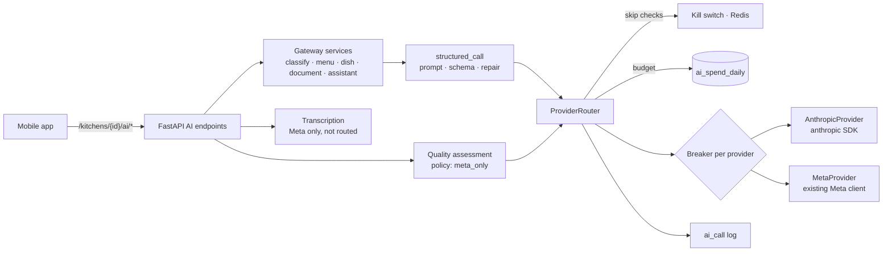

# AI providers: Anthropic primary, Meta fallback

Status: Phase 8, Step 1 (provider layer, failover and tests). Chat streaming is Step 1b,
and the eval parity report is Step 2. Anthropic specifics were verified against the
Claude API docs and the installed SDK on **2026-11-18**: Python SDK `anthropic==2.10.0`,
API version `2026-10-21`.

## Architecture



| Layer | File |
|---|---|
| Neutral request/result and typed errors | `backend/app/modules/ai/providers/base.py` |
| Router (failover, retries, repair, logs) | `backend/app/modules/ai/providers/router.py` |
| Anthropic adapter | `backend/app/integrations/anthropic/client.py` |
| Meta adapter (wraps the existing client unchanged) | `backend/app/modules/ai/providers/meta_provider.py` |
| Model tiers, capabilities, prices, wire schema | `backend/app/modules/ai/providers/catalog.py` |
| Circuit breaker | `backend/app/modules/ai/providers/breaker.py` |
| Daily spend and budgets | `backend/app/modules/ai/providers/spend.py`, table `ai_spend_daily` |
| Kill switch | `backend/app/modules/ai/providers/killswitch.py` |
| Health and startup config check | `backend/app/modules/ai/providers/health.py` |
| Ops endpoints | `backend/app/modules/ai/ops_router.py` |

Feature code calls only `structured_call` (or, for quality assessment, the router), and
never a provider directly.

## Failover rules

The first rows **skip** the primary without calling it: the log has
`outcome=primary_skipped` and a `skip_reason`, and `fallback_reason` stays empty. The
other rows call the primary first: a real failover logs `outcome=fallback` with a
`fallback_reason`.

| Condition | Behaviour | Logged as |
|---|---|---|
| `ANTHROPIC_API_KEY` empty | Skip Anthropic, Meta serves | `skip_reason=no_key` |
| Only the misspelled `ANTROPIC_API_KEY` set | Value never used. Startup warning, `/ai/health` shows `primary_misconfigured` | `skip_reason=no_key`, `env_name_typo` |
| `ANTHROPIC_ENABLED=false` | Skip Anthropic (restart required) | `skip_reason=disabled` |
| Kill switch on | Skip within about 5 s on every instance, no restart | `skip_reason=kill_switch` |
| Breaker open | Skip until cooldown, then one probe | `skip_reason=breaker_open` |
| Daily budget reached | Per `AI_BUDGET_EXCEEDED_ACTION`: `fallback` → Meta (skip), `cheaper_tier` → FAST model, `block` → 429 `AI_BUDGET_EXCEEDED` | `skip_reason=budget` |
| Timeout, including the router's own deadline | Fail over | `fallback_reason=timeout` |
| Network or DNS error | Retry (backoff + jitter), then fail over | `network` |
| 5xx, or 529 `overloaded_error` | Retry, then fail over | `overloaded` |
| 429 | Retry, honouring `retry-after` if it fits the budget, then fail over | `rate_limited` |
| 401 / 403 | Fail over. Logged `critical`; provider flagged misconfigured | `auth` |
| Output invalid after ONE repair | Fail over | `schema_fail` |
| Unexpected SDK exception | Fail over | `unexpected` |
| 400, 404 model, 413 | **No failover.** 502 `AI_PROVIDER_ERROR`, logged at `error` level (our bug) | `bad_request` |
| Model refusal (`stop_reason: refusal`) | **No failover, never retried on Meta.** 422 `AI_REFUSED`; the app shows a localized "I can't help with that" | `refused` |
| Both providers attempted and failed, or none available | 503 `AI_UNAVAILABLE`; the app shows "AI is temporarily unavailable" and manual flows work | `both_failed` |
| Only Meta attempted (no key) and it fails | Same errors as before Phase 8: 504 `AI_TIMEOUT`, 422 `AI_BAD_OUTPUT`, 502 `AI_PROVIDER_ERROR` | the error kind |
| **Classify:** Claude fails or times out (any reason except a refusal) | **No failover** (`policy=no_failover`). Claude gets the whole 15 s budget; on failure the endpoint returns 200 with `status: "classify_unavailable"` (kind, confidence and quality null) and the app asks the chef "What is this photo? Menu · Dish · Delivery note". Instant and always right, instead of waiting 8–12 s for Meta. When Claude is *skipped* (no key, disabled, kill switch, breaker open, budget) Meta still classifies as before | `outcome=<error kind>`, `policy=no_failover`, no `fallback_reason` |

Retries are at most `AI_ROUTER_MAX_RETRIES` (capped at 2) per provider. They happen only
before any output is returned, and only while the time budget allows. All routed calls
are side-effect free: the model only *proposes*. Writes happen later, after the chef
confirms an Action Card, through the normal APIs with idempotency keys. A failover
therefore can never execute a write twice.

**Time budgets include the fallback.** When a fallback exists, the primary gets
`AI_PRIMARY_BUDGET_SHARE` (default 60 %) of the feature budget. On the last provider, a
repair gets at least 3 s, as before Phase 8. The router enforces every attempt's deadline
with `asyncio.wait_for`, because httpx timeouts apply per phase (connect, write, read):
before this, a 10 s classify was measured running for 18.7 s.

**Measured latency (2026-11-18, dev, synthetic images):**

| Feature | Claude | Meta |
|---|---|---|
| Classify | 1.8–5.8 s (Haiku) | 7.6–11.7 s |
| Menu scan | 4.6–6.9 s (Sonnet) | 26.8 s |
| Dish photo | 4.2–6.0 s (Sonnet) | 22.3 s |
| Assistant turn | 2.2–3.0 s (Sonnet) | 12.3–13.6 s |

When the primary fails fast (auth, 5xx), Meta has almost the whole budget. When the
primary *times out*, Meta gets only the remaining 40 %, which is less than Meta needs
for menu and dish (12 s of 30 s). The budgets and the share are tuned in Step 2.

## Behaviour consistency

- **Same schemas for both providers.** The server validates every answer with the Pydantic
  model, and the app validates again with zod.
- **Anthropic gets JSON through structured outputs** (`output_config.format`). Keywords the
  API rejects with a 400 (`minimum`, `maxLength`, `pattern`, `maxItems`, …) are stripped
  from the *wire* schema only (`catalog.wire_schema`); validation still uses the full model.
- **The Assistant keeps the JSON-proposal format.** In its wire schema
  (`ModelAgentTurnWire`) `params` is a JSON-encoded *string*. A free-form dict only
  allows `{}` under structured outputs, and the union of the eight action parameter
  models is rejected by the API ("The compiled grammar is too large", verified live
  2026-11-18; a flattened single object is rejected as "Schema is too complex").
  `ModelAgentTurn` decodes the string and validates it against the typed params model of
  the chosen action, exactly as it validates Meta's dict. Action Cards and
  `resolve_references` are unchanged.
- **No temperature on Claude 5.5 models.** These models reject sampling parameters with a
  400, and SDK 2.x has no `temperature` argument. The capability map
  (`AI_MODEL_CAPABILITIES`) decides per model, and unknown models get no temperature and
  no effort. Determinism comes from structured outputs plus server validation, with
  `effort=low` for classification. Effort for extraction and chat is chosen from the
  Step 2 evals. Meta settings are unchanged.
- **`output_config` takes `format` and `effort` together.** Verified live on 2026-11-18
  for `claude-haiku-5-5` and `claude-sonnet-5-5`, with effort `low` and `medium`: every
  call returned 200 with schema-valid JSON. The capability map keeps
  `supports_effort=true` for both.
- **Prompts** live in `prompts/<feature>/<version>/meta.md`, byte-identical to the
  pre-Phase-8 files. A provider-specific `anthropic.md` beside it is used only where
  needed; none is needed yet, because every prompt already demands JSON only and treats
  text inside images as data, not instructions.
- **Locale** is passed on every call, and replies come back in EN/FR/RW. Dish names stay
  as written.

## Configuration

All values are server environment variables. `backend/.env.example` holds placeholders
only.

| Variable | Default | Notes |
|---|---|---|
| `AI_PRIMARY_PROVIDER` / `AI_FALLBACK_PROVIDER` | `anthropic` / `meta` | Fallback may be `none` |
| `ANTHROPIC_API_KEY` | empty | Empty means Meta only (identical to before) |
| `ANTHROPIC_ENABLED` | `true` | Hard off switch (restart) |
| `ANTHROPIC_MODEL_FAST` / `_STANDARD` / `_ADVANCED` | `claude-haiku-5-5` / `claude-sonnet-5-5` / `claude-opus-5-5` | Tiers: classification = fast; menu, dish, document and assistant = standard; advanced only if evals prove it is needed |
| `ANTHROPIC_EFFORT_CLASSIFY` / `_EXTRACT` / `_CHAT` | `low` | |
| `AI_TIMEOUT_CLASSIFY_MS` / `_EXTRACT_MS` | 15000 / 30000 | Total budget, fallback included, enforced by the router (`asyncio.wait_for`). Classify was 10000; raised because Meta alone takes 7.6–9.8 s (measured 2026-11-18) |
| `AI_TIMEOUT_CHAT_TTFT_MS` | 8000 | Used from Step 1b (streaming). Until then the Assistant uses `AI_CHAT_TIMEOUT_SECONDS=30` |
| `AI_PRIMARY_BUDGET_SHARE` | 0.6 | |
| `AI_ROUTER_MAX_RETRIES` | 1 | 0–2 |
| `AI_BREAKER_FAILURE_THRESHOLD` / `AI_BREAKER_COOLDOWN_MS` | 5 / 30000 | In-process, per instance |
| `AI_DAILY_BUDGET_USD` / `AI_KITCHEN_DAILY_BUDGET_USD` | 0 (off) | |
| `AI_BUDGET_EXCEEDED_ACTION` | `fallback` | `cheaper_tier`, `fallback` or `block` |
| `AI_MODEL_CAPABILITIES` / `AI_MODEL_PRICES` | see `config.py` | JSON overrides |
| `AI_OPS_TOKEN` | empty | Protects `/api/v1/ai/*`; empty means the endpoints return 404 |
| Existing Meta variables | unchanged | `MODEL_API_KEY`, `META_MUSE_SPARK_MODEL`, … |

The startup check logs a warning, and never crashes, when the primary is unconfigured,
disabled, or set under the misspelled name. It also warns when `ANTHROPIC_API_KEY` in the
process environment (for example a Windows user variable) overrides a *different* value
in `backend/.env`: process variables win, so a stale variable silently replaces the key
in `.env`. Only the fact is logged, never either value.

Startup also builds the Anthropic SDK client, so the first chef request does not pay the
import (measured: several seconds on a cold process).

## Cost model

Prices are USD per million tokens, from the Claude pricing table on 2026-11-18. They live
in `AI_MODEL_PRICES`.

| Model | Input | Output | Cache read | Cache write (5 min) |
|---|---|---|---|---|
| `claude-haiku-5-5` | 0.10 | 0.50 | 0.01 | 0.125 |
| `claude-sonnet-5-5` | 2.00 | 10.00 | 0.10 | 2.50 |
| `claude-opus-5-5` | 4.00 | 20.00 | 0.20 | 5.00 |
| `muse-spark-1.3` / `1.2` / `1.1` (Standard mode) | 1.25 | 4.25 | 0.15 | 1.25 (no cache-write price listed; billed as input) |

Meta prices come from <https://dev.meta.ai/docs/pricing-rate-limits>, fetched on
2026-11-18. The page shows no effective date, so re-check it whenever the bill differs.
These are **Standard-mode** prices (the mode this app uses); Contributor mode is cheaper
but has different data-use terms and is not used. Speech-to-text (Muse Voice Transcribe)
is billed per audio time, $0.18 per hour, and is not part of `ai_spend_daily`. A Meta
model ID missing from `AI_MODEL_PRICES` (for example a custom `META_MUSE_SPARK_FAST_MODEL`)
is recorded at $0.

- Cost per call is calculated from the response `usage`: input, output, cache-read and
  cache-write tokens.
- Every billed attempt is recorded in `ai_spend_daily`, including failed and refused
  ones. Each attempt is written once globally and once per kitchen, with an atomic upsert.
- The system prompt is marked for prompt caching. Prompts below the model's minimum
  cacheable length simply don't cache, without any error. `cached_tokens` in the logs
  shows the real hit rate.
- **Image limits.** Verified against the Claude vision docs on 2026-11-18:
  - Formats: JPEG, PNG, GIF and WebP.
  - Size and dimensions: at most 10 MB per image (base64), up to 8000×8000 px.
  - Claude 4.7 and later models (including the 5.5 tier) take a long edge up to 2,576 px
    and up to 4,784 visual tokens. Larger images are downscaled.
  - Cost: `⌈w/28⌉ × ⌈h/28⌉` visual tokens per image.

  The app already resizes images (about 1600 px for menus, 1024 px for dishes) and sends
  JPEG under 1 MB, so both providers get the same input. A 1600×1200 menu photo costs
  58 × 43 = 2,494 visual tokens, about $0.005 on Sonnet 5.5. The server accepts only
  JPEG, PNG and WebP (`validate_image`).
- The Message Batches API is not used, because there are no non-interactive bulk AI jobs
  today.

## Observability

Each routed call logs one `ai_call` event with these fields:

- `feature`, `prompt_version`, `request_id`, `kitchen_id`
- `provider_attempted`, `provider_served`, `fallback_reason`, `model`
- `skip_reason`: why the primary was not called (no_key, disabled, kill_switch, budget,
  breaker_open)
- `latency_ms`, `input_tokens`, `output_tokens`, `cached_tokens` (cache reads),
  `cache_write_tokens`, `cost_usd`
- `outcome`: success, repaired, **primary_skipped** (the primary was not called; see
  `skip_reason`), **fallback** (the primary was called and failed; see `fallback_reason`),
  schema_fail, timeout, refused, bad_request, both_failed or budget_blocked
- `repaired`
- `policy`: set for non-default routing (`no_failover` for classify, `meta_only` for
  quality assessment)

The chef's action (accepted, edited or rejected) is logged separately as `ai_feedback`.
No prompts, images, answers or keys are logged.

Saved queries (structured JSON logs):

| Panel | Query |
|---|---|
| Fallback rate (real failovers) | `event=ai_call outcome=fallback` / `event=ai_call outcome in (success, repaired, fallback, schema_fail, timeout, both_failed)`, by `feature` and `fallback_reason` |
| Primary skipped | `event=ai_call outcome=primary_skipped` by `skip_reason`. Expected while the key is unset, `ANTHROPIC_ENABLED=false` or the kill switch is on; not an error |
| Error rate by provider | `event=ai_call outcome in (timeout, schema_fail, both_failed, bad_request)` grouped by `provider_attempted` |
| p95 latency | `event=ai_call` p95(`latency_ms`) by `feature`, `provider_served` |
| Cost per day / feature | `SELECT day, scope, provider, model, SUM(cost_usd) FROM ai_spend_daily GROUP BY 1,2,3,4`, plus `event=ai_call` sum(`cost_usd`) by `feature` |
| Schema-fail rate | `event=ai_call outcome=schema_fail` / all, by `feature` |

Alerts:

- Fallback rate above 10 % for 15 min, counting `outcome=fallback` only. Skipped calls
  (`outcome=primary_skipped`) are left out, so an intentionally disabled primary never
  pages anyone.
- `skip_reason=breaker_open` or `skip_reason=budget` for more than 15 min (the primary
  is being bypassed because of errors or spend, not by choice).
- Any `ai_provider_auth_failed`.
- `ai_budget_alert` (80 % of a cap) and `ai_budget_reached`.

## Runbook

**Check status:** `curl -H "X-Ops-Token: $AI_OPS_TOKEN" https://<api>/api/v1/ai/health`. It
shows configured, enabled, kill switch, breaker state, last success, p95 and the
misconfiguration reason for each provider, plus `redis_connected` (Redis answered a ping
within 0.5 s). It never shows key material.

**Turn the primary off instantly (no deploy, no restart):**

```bash
curl -X PUT -H "X-Ops-Token: $AI_OPS_TOKEN" -H "Content-Type: application/json" \
  -d '{"on": true}' https://<api>/api/v1/ai/kill-switch/anthropic
```

This takes effect on every instance within about 5 s (measured: 4.9 s). **Redis is
required in production** for this: without it (`redis_connected: false`) the switch only
reaches the instance that received the request. Redis must not evict the key: use
`volatile-lru` or `noeviction` (Docker Compose uses `volatile-lru`). To turn the primary
back on, send `{"on": false}`. The permanent switch is `ANTHROPIC_ENABLED=false` followed
by a restart.

**Rotate the Anthropic key:**

1. Create a new key in the Claude Console.
2. Set `ANTHROPIC_API_KEY` in the server secret store.
3. Restart.
4. Check that `/ai/health` shows `configured=true` and that `provider_served=anthropic` appears.
5. Revoke the old key.

If the old key is revoked first, calls fall back to Meta with `fallback_reason=auth`
until the new key is in place, so chefs are not blocked.

**Respond to alerts:**

- `auth`: check the key and the workspace. Meta is serving in the meantime.
- High fallback rate: check `/ai/health` (breaker open, last error) and the Claude status
  page. Flip the kill switch if errors are slowing chefs down.
- `ai_config_warning` "overrides a different value in .env": remove the stale
  `ANTHROPIC_API_KEY` from the host environment (on Windows, the user variables) and
  restart.
- Budget alert: raise the cap or set `AI_BUDGET_EXCEEDED_ACTION=cheaper_tier`.

**Rollback:** use the kill switch, or `ANTHROPIC_ENABLED=false`. Both route everything to
Meta exactly as before Phase 8.

## Known limits (Step 1)

- No chat streaming yet. Step 1b adds SSE with pre-first-token failover only; a
  mid-stream failure becomes "interrupted, retry".
- The breaker and latency stats are per instance. Spend is shared through Postgres.
- Eval parity (Step 2) is prepared in `ai-evals/parity.py`; rules and cases in
  `ai-evals/PARITY.md`. Not run yet.
- Quality assessment is routed but pinned to Meta (`meta_only`) until it has eval cases
  and passes parity.
- The `/ai/health` p95 covers only this instance's last 200 calls.

## Open items

The single list of what is still open for Phase 8 and around it. Update it when an item
moves; close an item by deleting its row and noting the commit.

| Item | Owner | Status (2026-11-19) | Blocks | Where |
|---|---|---|---|---|
| **Rotate the Meta key leaked in `41c7efc`** | Product owner | Pending. The key is still active; `.gitleaksignore` allowlists the finding marked "PENDING ROTATION — key still active". After rotating, update that comment, then verify the Meta path with the new key | Nothing in code; it is a live credential exposure until rotated | `docs/security/secret-history-purge.md`, `.gitleaksignore` |
| **Decide on the Git history purge** | Product owner | Not decided. Commands prepared, not run. Rotation makes the leaked value useless; a purge only removes it from history and needs a coordinated force-push | — | `docs/security/secret-history-purge.md` |
| **Step 1b: Assistant streaming (SSE)** | Engineering | Planned, not started. Pre-first-token failover only; a mid-stream failure shows "interrupted, retry"; 8 s time-to-first-token budget; mobile streaming client | **Required before the Assistant uses Claude for real users** | Plan in the Step 1 review; `AI_TIMEOUT_CHAT_TTFT_MS` |
| **Step 2: eval parity** | Engineering + product owner | Harness ready; 20 photos filed as draft answer keys, waiting for review (`ai-evals/review.html`) and "answers verified". Then 3 runs × meta / claude-low / claude-medium, hard cap $25 | Step 3 canary per feature | `ai-evals/PARITY.md` |
| **Step 3: rollout** | Engineering | Not started. Staging with the full suite green, optional shadow mode, then canary 10 % → 50 % → 100 % of kitchens per feature. Classify, menu, dish and document may start after they pass the Step 2 bar; the Assistant waits for Step 1b. Rollback: kill switch or `ANTHROPIC_ENABLED=false`, verified without a deploy | — | This document, "Runbook" |
| **Food Bundles order status and payment API contract** | Product owner with Food Bundles | No contract yet. Needed for real `dispatched_at` / `paid_at` (cancel rule), status webhooks and cancelling on the Food Bundles side. Today `out_for_delivery` means "chef started receiving" | Correct order-cancel rule after dispatch or payment | `backend/README.md` section 4.5 (fields and events listed) |
| **SMS gateway outside Rwanda** | Engineering | OTP SMS uses Pindo (Rwanda) with Rwandan phone normalisation. Kitchens elsewhere need an international SMS provider and E.164 handling | Sign-in for kitchens outside Rwanda | `backend/app/integrations/sms/` |
| **Exchange-rate primary key** | Product owner | Not bought. **Frankfurter is the only source** until then (daily central-bank rates, none at weekends; the 3-day window covers them). Before buying ExchangeRate-API Pro, get written confirmation that showing the rate next to a conversion in our app is allowed (its terms forbid re-distribution); question drafted in the licence doc. Then set `EXCHANGE_RATE_API_KEY` in the server env only | Hourly rates; a second independent source | `docs/design/exchange-rate-licences.md` |
| **Exchange-rate job in production** | Engineering / ops | The job runs in the arq worker (`arq app.workers.scheduler.WorkerSettings`; the `worker` service in `backend/docker-compose.yml`), not in the API process. `backend/docker-compose.prod.yml` now runs it as the `worker` service with an `arq --check` health check, and the one-shot `worker-check` fails the deploy unless a rates fetch is < 24 h old. Still unknown: whether today's hosting runs a worker at all (questions in `docs/deployment.md`). After deploy, `GET /api/v1/ai/rates-health` (ops token): `healthy: true`, no `missing` | Conversions in production | `docs/deployment.md` |
| **Speech-to-text default language** | Engineering | Defaults to Kinyarwanda (`rw`); should default to the app language | Voice for non-Rwandan kitchens | `backend/app/modules/ai/schemas/transcription.py` |
| **Food Bundles catalogue by country** | Product owner | Rule decided 2026-11-19: catalogue and requisition-from-catalogue only for kitchens in countries Food Bundles serves (config, default `["RW"]`); others use manual items. Built in Step 2a | Ordering from Food Bundles outside served countries | `docs/design/global-readiness.md` decision 9 |
| **mypy typing debt** | Engineering | 144 strict-mode errors in 39 files (`cd backend && mypy app`, measured 2026-11-18). The pre-commit hook checks staged files only (`--follow-imports=silent`), so each touched file must be fixed when it is next committed | Turning on a full `mypy app` CI gate | `backend/.pre-commit-config.yaml`, `backend/pyproject.toml` |
